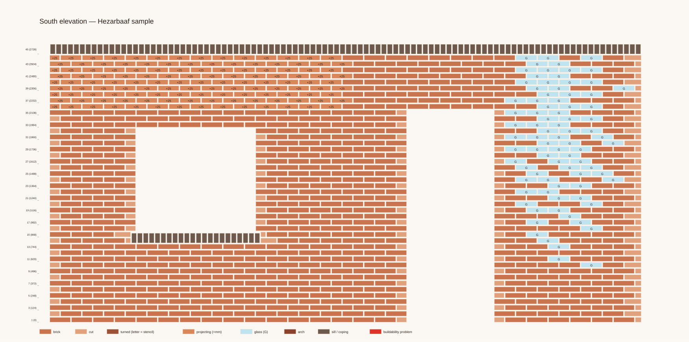
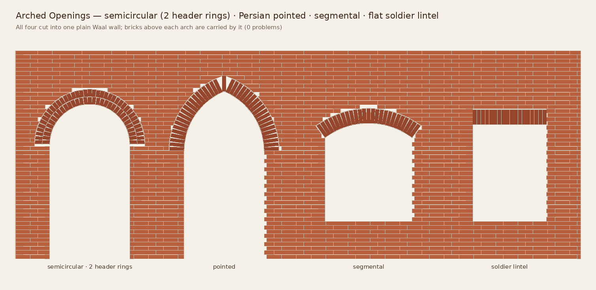
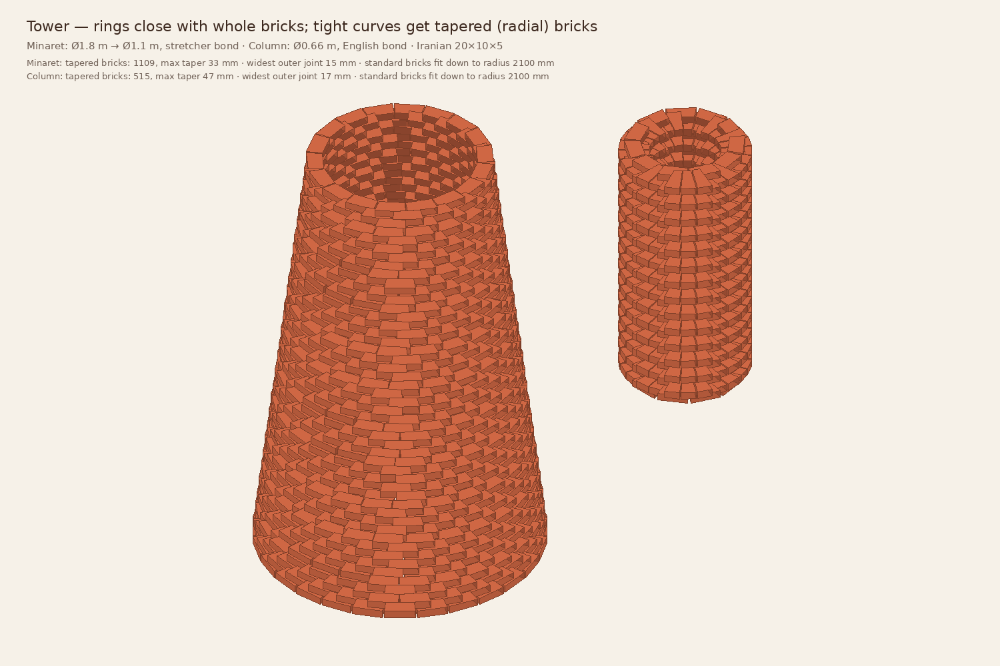
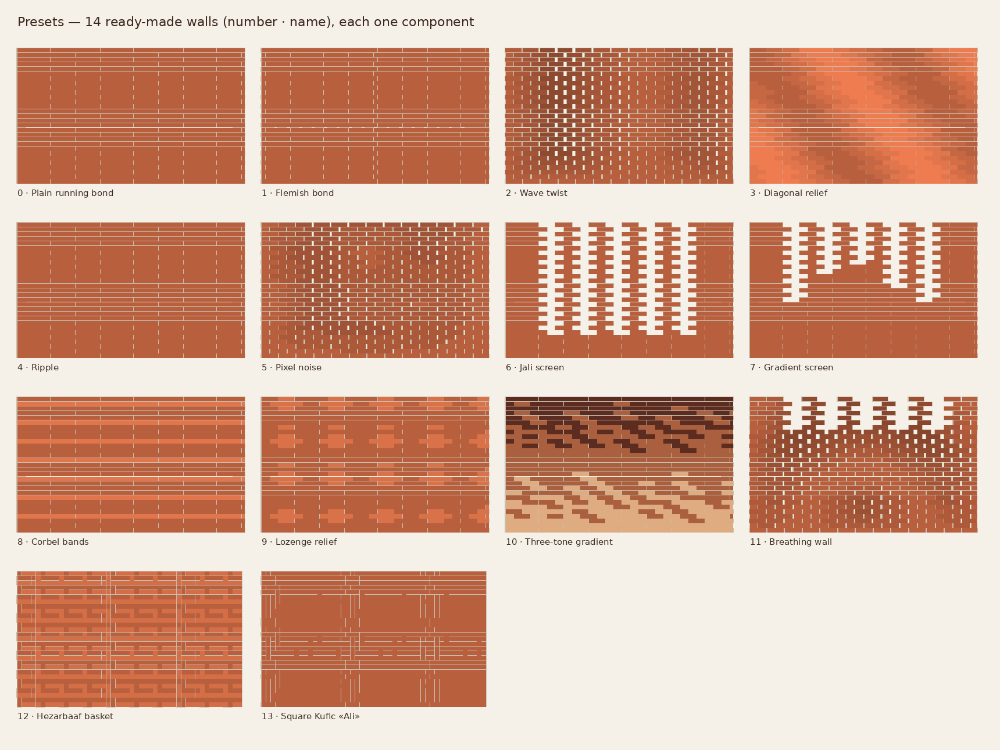
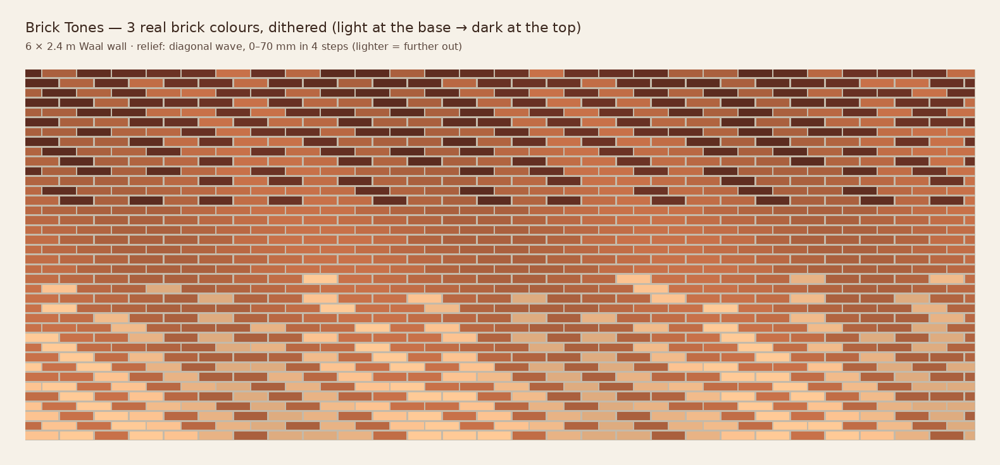
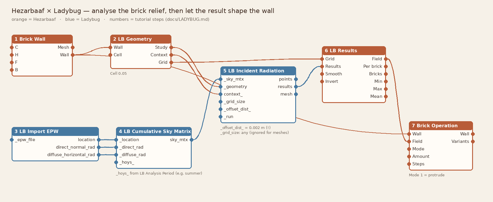

# Hezarbaaf · هزارباف

*"Thousand weaves"* — buildable parametric brickwork for Rhino/Grasshopper, inspired by Persian *hazarbaf* (woven relief) brickwork. Plan & roadmap: `iamilio/ideas-vault` → IDEA-002.

## Structure
```
src/MasonryCore   plain C# brick engine (netstandard2.0, no Rhino dependency)
src/MasonryGH     Grasshopper plugin (.gha) – thin layer over the core
tests/            dependency-free test runner for the core
```

## Status: Phase 1 start
- Brick formats (NL, UK, US, Iranian — verify dimensions)
- Bonds: Stretcher, Stack, English, Flemish (data-driven; end closers are simple cuts for now)
- Wall along any curve + height, cut bricks at ends, quantities
- 24k bricks in ~20 ms (core, no rendering)

## Build the plugin (Windows/Mac with Rhino 8)
1. Install .NET SDK 8 (and Visual Studio 2022 or Rider)
2. `dotnet build src/MasonryGH -c Release`
3. In Grasshopper: File → Special Folders → Components Folder → copy `Hezarbaaf.gha` + `Masonry.Core.dll` from `src/MasonryGH/bin/Release/net7.0/` (Rhino 8) or `net48/` (Rhino 7)
4. Restart Rhino → new **Hezarbaaf** tab: *Brick Wall*, *Brick Formats*, *Bonds*

## Run core tests
```
dotnet run --project tests/MasonryCore.Tests -c Release -p:CoreTfm=net8.0
```

## Toolbar: simple first

Hezarbaaf adds two tabs to Grasshopper:

| Tab | Panels | Components |
|---|---|---|
| **Hezarbaaf** (the essentials) | 1 Start | Presets · Brick Wall |
| | 2 Design | Field Attractor · Field Wave · Brick Operation |
| | 3 Build | Brick Output · Bake Blocks |
| **Hezarbaaf Advanced** | 1 Walls | Quick Façade, Corner, Loft, Section, Surface, Tower, Arched Openings |
| | 2 Fields | Ripple, Noise, Bitmap, Combine, Preview |
| | 3 Operations | Brick Tones, Glass Bricks |
| | 4 Hezarbaaf | Hezarbaaf Wall, Motif Transform, Image Motif |
| | 5 Site | Raj Sheet, Quantities, Rotation Stencils, Assembly Order, Elevation Drawing |
| | 6 Ladybug | Ladybug Geometry, Ladybug Results |
| | 7 Library | Brick Formats, Bonds, Language |

Most designs need only the first tab: **pick a preset or draw a wall → shape it with a field → bake it.**

Hezarbaaf is about **parametric brick walls**. It doesn't do form-finding (use RhinoVAULT or Kangaroo), structural analysis (Karamba) or sun/energy studies (Ladybug: see the [bridge](docs/LADYBUG.md)).

## Features (v0.8)

**Road to 1.0: [final scope](docs/ROADMAP-1.0.md).** **First time testing? Follow [TESTING.md](docs/TESTING.md).** **New here? Start with the Presets component — 14 ready-made walls — then the [examples](docs/EXAMPLES.md).**

| Area | What you get | Grasshopper |
|---|---|---|
| Walls | Any curve + height, 4 bonds, 7 brick formats, cut bricks, quantities | Brick Wall |
| Coloured preview | Brick Output shows the wall coloured by status: **red = problem**, cut, turned, projecting, tapered, arch, sill/coping, glass, or by material (tones, glaze, glass) | Brick Output |
| Glass + brick | Glass bricks mixed in by a field (share of glass), spread evenly; counted and priced separately | Glass Bricks · آجر شیشه‌ای |
| Details | Tidy jambs (whole or half bricks at every opening edge), brick-on-edge sills under windows, coping on top | Details · جزئیات |
| Elevation drawing | Printable site elevation: every brick, course numbers + heights, stencil letters, ± relief, glass, legend; Rhino curves + text or an SVG file ([sample](docs/elevation-sample.svg)) | Elevation Drawing · نقشهٔ نما |
| Presets | 14 ready-made walls (running, Flemish, wave twist, ripple, jali, gradient screen, corbel bands, lozenge, 3-tone, breathing wall, Hezarbaaf basket, Kufic «Ali» …) by number or name | Presets · نمونه‌ها |
| Arches | Semicircular, segmental, Persian pointed (جناغی) arches and soldier lintels; rowlock/header rings, 1–3 rings; wall cut around the ring; joint report + tapered-voussoir warning; arches carry the wall above | Arched Openings · طاق و درگاه |
| Any surface | Bricks course by course on any (poly)surface: holes become openings with a continuous bond, lean becomes checked corbelling | Surface Wall · دیوار روی سطح |
| Towers | Round towers, minarets, columns, dome/badgir profiles; rings close with whole bricks; tapered (radial) bricks where the curve is tight, shown as wedges and listed for cutting | Tower · برج و ستون |
| Corners | Polyline or closed room; corners interlock course by course (walls take turns running through), any angle | Corner Wall · دیوار با کنج |
| Custom bricks & bonds | Type a size into any Format input: `230x110x50 j10/12` (فارسی digits OK). Type a bond: `S:0 \| S:-0.25 \| S:-0.5` (S stretcher, H header, offsets in bricks / `h` / `mm`) | every Format / Bond input |
| Openings | Windows/doors cut cleanly at jambs, snapped to courses, lintel-aware checks | Brick Wall (OU/OV), Quick Façade |
| Fields | Point & curve attractors, wave, ripple, noise, bitmap (via Image Sampler), combine / invert / contrast, bitmap→wave | Field Attractor · Wave · Ripple · Noise · Bitmap · Combine |
| Operations | Rotate, protrude/recess, remove, checkerboard perforation (always supported), **buildable steps** | Brick Operation |
| Checks | Real plan collision test, support below, corbel overhang; problem bricks listed | Brick Output |
| Noob mode | Flat façade with holes → finished brick system with 5 sliders; auto open head joints for rotation; calm zones at openings, base and corners | Quick Façade · نمای سریع |
| Loft walls | Wall through 2, 3+ curves (smooth), or plan + section profile (lean / bulge / wave); overhang checks per course | Loft Wall · Section Wall |
| Raj sheets | Course-by-course instructions in فارسی / English, grouped like knot calls; CSV schedule per brick; save to folder | Raj Sheet · رج‌شیت |
| Quantities | Bricks to order (waste, shared cuts), glazed per colour, mortar m³, weight, cost, labour hours | Quantities · متره و برآورد |
| Stencils | One printable 1:1 template per brick angle, with string line, straight-brick reference and count — the mason turns each brick to match | Rotation Stencils · شابلون چرخش |
| Field preview | Heatmap of any field on the façade before laying a single brick | Field Preview · پیش‌نمایش میدان |
| Ladybug | Wall → Ladybug study mesh (one sensor per face on the brick fronts) + context; Ladybug results → per-brick values, coloured bricks and a 0..1 field that drives any operation (radiation-driven relief, tones, perforation). [Tutorial](docs/LADYBUG.md) | Ladybug Geometry · Ladybug Results |
| Brick tones | A field becomes 2–6 real brick colours (batches to order), dithered so a 3-tone mix reads as a smooth gradient; counts per tone in Quantities, Raj sheets and Bake layers | Brick Tones · رنگ‌آمیزی آجر |
| Assembly | Placing order (course by course, serpentine for robots, racked lifts for scaffold bays), place planes at the top-face centre, CSV for robots/site, check that nothing is placed before its support | Assembly Order · ترتیب اجرا |
| Bake | Bricks → Rhino block instances (one block per size), layers per glaze, problems named, one undo | Bake Blocks |
| Hezarbaaf | Woven relief motifs, square Kufic «علی», frame/rotate/mirror/fourfold; **image → motif** (palette `CAB` relief, `AG` gold, `.A` screen) | Hezarbaaf Wall, Banna'i Motif, Image Motif |















*3-curve loft (straight bottom, bulging middle, wavy top) + ripple rotation in 3 steps — 0 buildability problems.*

### Typical chains
- `Brick Wall → Brick Operation (+ Field) → Brick Output`
- `Quick Façade` alone (select surface, move sliders)
- `Loft Wall (2–3 curves) → Brick Operation → Raj Sheet + Quantities → Bake Blocks`

## Hezarbaaf system (هزارباف)
Woven relief brickwork from a tiny text "motif" — like pixel art where each character is a grid cell:

```
"AAAABBAAAA"     UPPERCASE = horizontal brick (equal letters in a row join into one brick)
"AAABBBBAAA"     lowercase = vertical brick   (equal letters in a column join)
"AABBCCBBAA"     A flush · B projects out · C recessed · G glazed · . empty
```
The motif repeats across any wall (straight or curved). Pieces longer than a real brick are split automatically.
Grasshopper: **Hezarbaaf Wall** component (preset name or your own rows).
Starter presets (Basket, Plaid squares, Lozenge steps, Cross relief) are placeholders — historical motifs to be added and verified.

Preview data from the real engine: `dotnet run --project tools/Preview -p:CoreTfm=net8.0`

---

<div dir="rtl">

## هزارباف · فارسی

**هزارباف** افزونه‌ای برای گرس‌هاپر (راینو) است که آجرکاری پارامتریکِ **قابل‌اجرا** می‌سازد؛ الهام‌گرفته از هنر ایرانیِ هزارباف، یعنی آجرکاری برجسته‌ای که مثل پارچه «بافته» به نظر می‌رسد.

### امکانات
- **نمای سریع**: سطح نمای یک ساختمان (با در و پنجره) را بدهید؛ با چند اسلایدر کل نما آجرچینی می‌شود.
- **دیوار**: از منحنی، پلی‌لاین با کنج‌های درگیر، لافت دو یا سه منحنی، روی هر سطح، و برج و مناره و ستون (آجر گوه‌ای برای قوس تند).
- **آجر و چینش**: آجر ایرانی، هلندی، انگلیسی یا هر اندازهٔ دلخواه (`230x110x50 j10/12`)؛ چینش راسته، روی‌هم، انگلیسی، فلمنکی یا دلخواه.
- **بند و ملات**: پهنای بند دلخواه؛ بند باز خودکار برای آجرهای چرخیده؛ حجم ملات در متره.
- **بازشو و طاق**: پنجره و در؛ طاق نیم‌دایره، کم‌خیز، جناغی و نعل‌درگاه راسته‌چین؛ آجر زیرپنجره، کلاهک دیوار، لبه‌های مرتب.
- **طراحی با میدان**: جاذب، موج، موج دایره‌ای، نویز، تصویر و ترکیب آن‌ها؛ برای چرخش، پیش‌آمدگی، حذف و مشبک‌کاری.
- **رنگ و جنس**: ترکیب چند رنگ آجر، آجر لعابی، آجر شیشه‌ای.
- **سیستم هزارباف**: نقش را مثل پیکسل می‌نویسید (جدول پایین)؛ کوفی بنایی؛ نقش از تصویر.
- **بررسی اجرایی**: آجرهای مشکل‌دار در پیش‌نمایش قرمز می‌شوند.
- **خروجی کارگاهی**: متره و هزینه، رج‌شیت، شابلون چرخش، نقشهٔ نما (SVG)، ترتیب اجرا، بِیک به‌صورت بلاک.
- **لیدی‌باگ**: تحلیل تابش روی نمای آجری و استفاده از نتیجه در طراحی ([راهنما](docs/LADYBUG.md)).
- **شروع سریع**: ۱۴ دیوار آماده؛ رابط فارسی و انگلیسی (با اعداد فارسی).

### تغییر زبان به فارسی
کامپوننت **Language · زبان** را روی بوم بگذارید، مقدار `fa` بدهید و راینو را دوباره باز کنید. نام کامپوننت‌ها، توضیحات و گزارش‌ها فارسی می‌شوند. نام‌های فارسی نقش‌ها، چینش‌ها و آجرها را هم می‌توانید مستقیم به ورودی‌ها بدهید.

### نوشتن نقش
| حرف | معنی |
|---|---|
| حروف بزرگ (A B C G) | آجر **خوابیده** — حروف یکسانِ کنار هم یک آجر می‌شوند |
| حروف کوچک (a b c g) | آجر **ایستاده** — حروف یکسانِ زیر هم یک آجر می‌شوند |
| A / a | هم‌سطح |
| B / b | پیش‌آمده |
| C / c | فرورفته |
| G / g | لعابی |
| . | خالی |

**واژه‌نامهٔ کامل (برای بازبینی معماران و بنّاها):** [docs/GLOSSARY.fa.md](docs/GLOSSARY.fa.md) · کوفی بنایی (نوشتن نام با آجر): [docs/KUFI.md](docs/KUFI.md)

</div>
