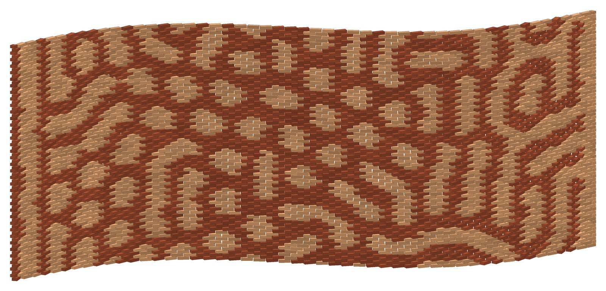
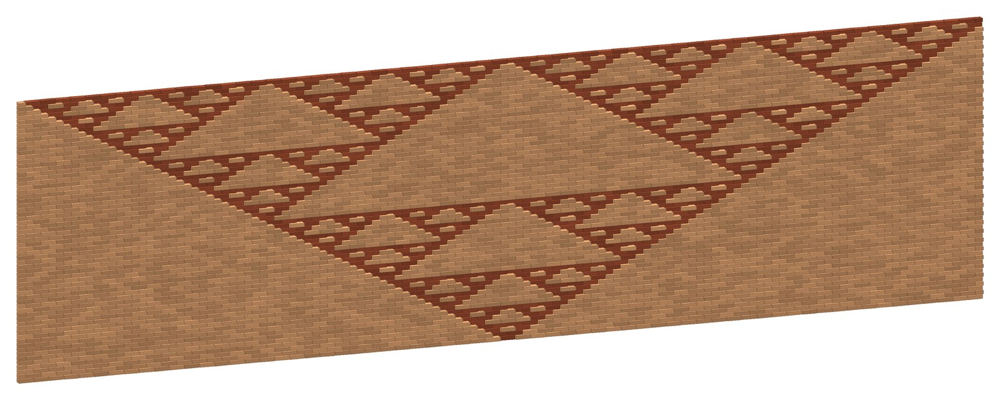
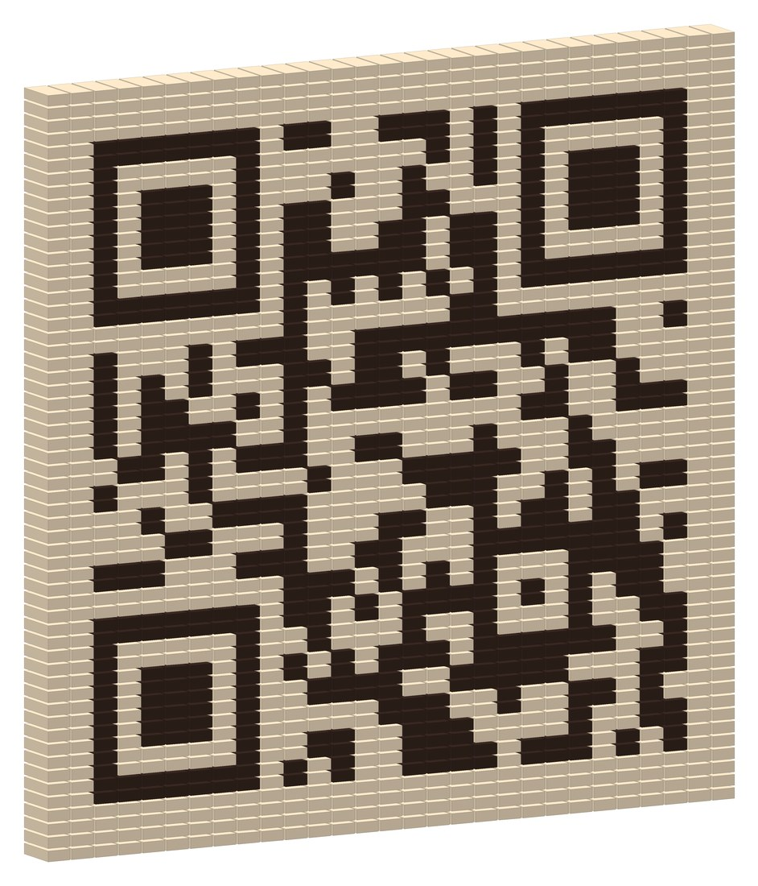

# Three original walls

Patterns that come from computation rather than from drawing. Each wall is real brickwork laid by the
Hezarbaaf core, and each passes the buildability checks with 0 problems.
The scripts are in `tools/Preview/Program.cs` (mode `projects`, section "original pieces").

## 1. Turing wall

A reaction–diffusion simulation (Gray–Scott), the chemistry behind leopard spots and zebra stripes, is run with
its feed rate changing along the wall, so the pattern goes from spots to stripes to a maze. The result turns the
bricks up to 40° in 5 steps and picks one of two brick tones. 11 × 4.5 m S-curve, 3,636 bricks, 8 stencils.

## 2. Gravity automaton

Every brick looks only at the two bricks it rests on: if exactly one of them sticks out, it sticks out too.
One seed brick in the first course grows a Sierpinski triangle, 64 courses high. The rule is the bond itself:
it only works because running bond puts each brick on two others. 14 × 4 m, 4,128 bricks, 25 mm relief.

## 3. A wall you can scan

A QR code in two brick tones. One module is one header by two courses (110 mm square with a 45 mm brick and
10 mm joints). 3.2 × 3.2 m, 1,682 bricks. The render above decodes to `HTTPS://GITHUB.COM/IAMILIO/HEZARBAAF`
with OpenCV's QR detector. Stacked headers don't interlock, so Hezarbaaf asks for bed-joint wire (8 joints, 25 m).
A real wall would need a strong tone contrast and mortar close to the light brick; that hasn't been tested on site.
