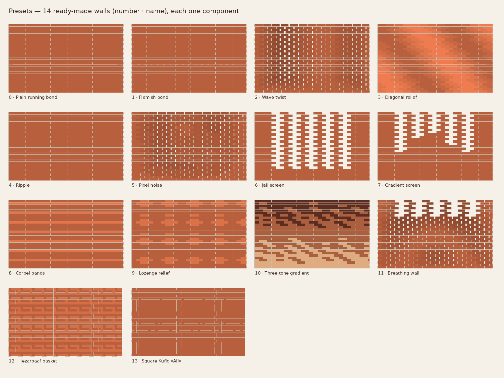
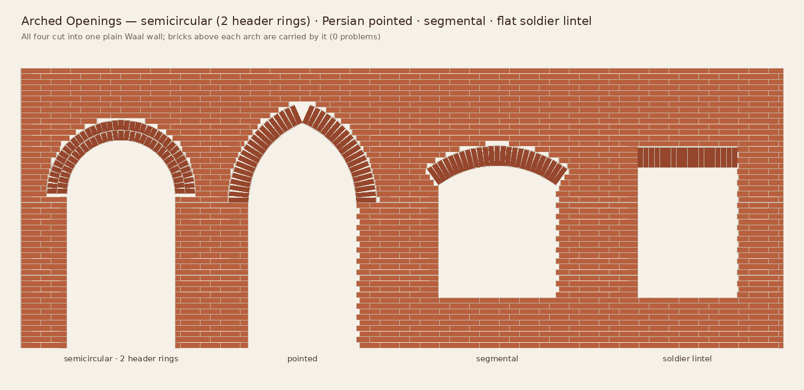
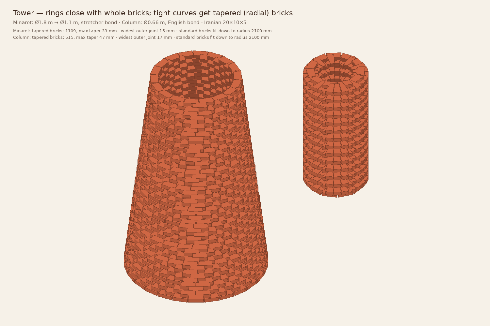

# Examples: one recipe per feature

Each recipe is a few components wired left to right. Draw the curves in Rhino, set them in Grasshopper and connect them.

> **About .gh files:** ready-to-open example files (`examples/*.gh`) will be saved straight from Grasshopper once the plugin's first build is tested. A hand-written file that doesn't open would be worse than none. Until then, the recipes below take about a minute each. **Presets** (recipe 0) is the fastest start.

Units are metres unless noted.

---

### 0 · Start from a preset · نمونه‌ها
`Curve` → **Presets** (`P` = 2) → `Mesh`

- Use `Names` with a Panel to see all 14 presets, and set `P` to any number (۰–۱۳ also works) or name.
- `Wall` continues into anything below, such as Raj Sheet, Quantities, Bake or Ladybug.

### 1 · Plain wall with openings
`Curve` → **Brick Wall** (`H` 3, `F` "Waal (NL)", `B` "Flemish", `OU` intervals, `OV` intervals) → `Mesh`

### 2 · Arched openings · طاق و درگاه
`Curve` → **Brick Wall** (no openings) → `Wall` → **Arched Openings**
- `C` = same curve
- `OU` = {1.0 to 2.2}, `OV` = {0 to 1.6}: OV ends at the springing line (پاطاق)
- `K`: 0 semicircular · 1 segmental · 2 pointed (جناغی) · 3 soldier lintel
- `Rg`: 0 rowlock · 1 header. `N` = rings. `S` = sharpness (pointed) or rise (segmental)

`Report` tells you the joint widths and whether tapered voussoirs are needed. The Raj sheet adds a line per arch saying to build on a timber centring, from both sides towards the crown.

### 3 · Brick on any surface · دیوار روی سطح
`Surface/Brep` → **Surface Wall** (`F`, `B`) → `Mesh`, `Courses`
- Holes in the surface become openings automatically, and the bond carries on across them.
- Leaning parts are corbelled course by course. If the lean is too steep, those bricks are flagged.
- Try a lofted, twisted surface: lean ±15°, 4 m high.

### 4 · Tower, minaret, column · برج و ستون
`Point` → **Tower** (`R` 0.9, `Rt` 0.55, `H` 3, `F` "Iranian 20x10x5", `B` "Stretcher") → `Mesh`
- Every ring closes with whole bricks. Below about 2 m radius, bricks become **tapered**: shown as wedges, counted in `Report` and listed in the Raj sheet.
- For a dome or badgir profile, draw a curve in the Front view (X = radius, Z = height) and connect it to `Pr`.

### 5 · Wave twist with stencils
`Brick Wall` → **Field Wave** → **Brick Operation** (mode 0, `A` 30, `S` 6) → **Rotation Stencils** → curves + `Label` to a Text Tag
- 6 steps = 6 stencils (A–F) to print at full size.

### 6 · Hezarbaaf motif from an image
`Image Sampler` (30 × 20) → **Image Motif** (`P` "CAB") → **Hezarbaaf Wall** · `Motif`

### 7 · Three brick colours
`Brick Wall` → **Field Attractor** → **Brick Tones** (`N` 3) → `Meshes` + `Colours` → Custom Preview; `Counts` → order list

### 8 · Ladybug-driven relief
See the full tutorial: [LADYBUG.md](LADYBUG.md).

### 9 · Build it
`Wall` → **Raj Sheet** (txt + CSV for the site) · **Quantities** (order, mortar, cost) · **Assembly Order** (robot CSV, place planes) · **Bake Blocks**

---

## خلاصه به فارسی

سریع‌ترین شروع، جزء **نمونه‌ها** است: یک منحنی بکشید، شمارهٔ نمونه (۰ تا ۱۳) را بدهید، تمام.

- **طاق و درگاه:** دیوار بدون بازشو + بازه‌های عرض و ارتفاع (تا پاطاق). نوع طاق: نیم‌دایره، کم‌خیز، جناغی، یا نعل‌درگاه راسته‌چین.
- **دیوار روی سطح:** هر سطحی را رج‌به‌رج آجرچینی می‌کند. سوراخ‌ها بازشو می‌شوند و شیب به پیش‌آمدگی تبدیل می‌شود.
- **برج و ستون:** حلقه‌ها بدون آجر بُرش‌خورده بسته می‌شوند. در شعاع کم، آجر گوه‌ای (تراشیده) پیشنهاد می‌شود.
