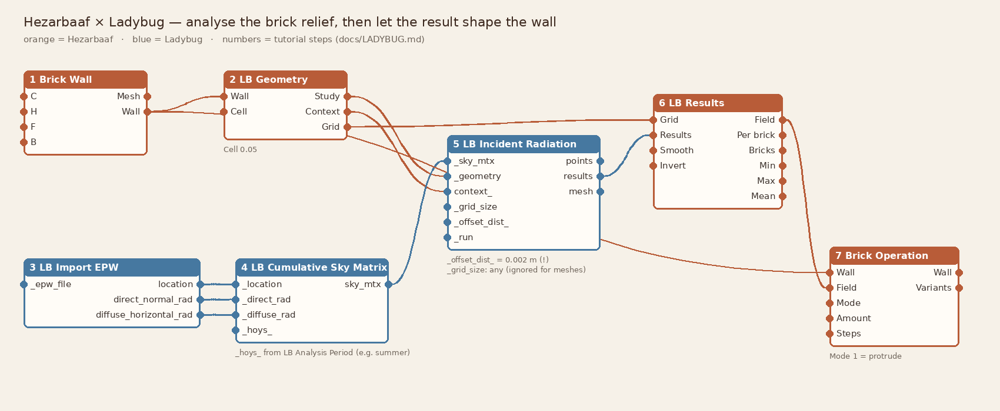

# Hezarbaaf × Ladybug: analyse the brick relief, then let the result shape the wall

Hezarbaaf does not calculate sun or radiation itself. [Ladybug Tools](https://www.ladybug.tools/) does that properly, with real weather files, sky models and context. Hezarbaaf provides two components that connect the two:

| Component | What it does |
|---|---|
| **Ladybug Geometry** · هندسه برای لیدی‌باگ | Turns a Hezarbaaf wall into a **Study** mesh, where each face is one sensor on a brick face, and a **Context** mesh made of all the bricks, so the relief shades itself. |
| **Ladybug Results** · نتایج لیدی‌باگ | Takes Ladybug's results back. Outputs a value per brick, the bricks coloured by result, min/max/mean, and a **0..1 field** that can drive any Hezarbaaf operation. |

You need Rhino 8, Hezarbaaf, and **Ladybug Tools 1.x** installed. The example below uses metres.

---

## Tutorial: radiation-driven brick relief

Here is the idea. Where a façade receives more summer sun, push the bricks further out, so they shade the wall below them. The steps match the numbers in the diagram.

### 1. Build a wall
**Brick Wall**: draw a curve, set H = 3, Format `Waal (NL)`, Bond `Stretcher`.

> A flat, straight wall with nothing around it gets the same radiation everywhere, so the result would be a flat field. Make the analysis worth it with at least one of these:
> - a **curved or folded** wall,
> - **context**: neighbouring buildings, a roof overhang, balconies or trees (join them into Ladybug's `context_`),
> - an existing **relief** (run a Brick Operation first and analyse that).

### 2. Prepare the geometry
**Ladybug Geometry**
- `Wall` ← the wall from step 1
- `Cell` = **0.05**: roughly one sensor row per brick course and four sensors per brick.

| Use a smaller cell (0.02) for | Use a larger cell (0.1–0.2) for |
|---|---|
| detail on one bay | whole buildings |

Outputs: `Study`, `Context`, `Grid`. Check `Info` for the sensor count. Above about 50,000 sensors Ladybug gets slow, so analyse one typical bay instead.

### 3. Weather
**LB Import EPW**: connect an EPW file. Get one from the LB "Download Weather" component or [climate.onebuilding.org](https://climate.onebuilding.org), for example Tehran Mehrabad, Yazd or Eindhoven.

### 4. Sky
**LB Cumulative Sky Matrix**
- `_location` ← `location`
- `_direct_rad` ← `direct_normal_rad`
- `_diffuse_rad` ← `diffuse_horizontal_rad`
- `_hoys_` ← optional: **LB Analysis Period** → `hoys`. For example, 21 June to 21 September only, if you design for **summer shading**. Leave it empty for the whole year.

### 5. Radiation
**LB Incident Radiation**

| Input | Connect / value | Why |
|---|---|---|
| `_sky_mtx` | from step 4 | |
| `_geometry` | **Study** from step 2 | It's a Mesh, so Ladybug uses *its faces* as sensors and doesn't re-grid them. That keeps the results in Hezarbaaf's order. |
| `context_` | **Context** from step 2, plus any neighbours | The bricks shade each other. |
| `_grid_size` | any number, e.g. 0.05 | Required, but ignored for meshes. |
| `_offset_dist_` | **0.002** | ⚠ The default is 10 cm, which lifts every sensor in front of the whole relief, so the bricks would never shade each other. Use 1–3 mm. |
| `_run` | True | |

`results` are in **kWh/m²** over the period. If `irradiance_` = True, they are average W/m².

### 6. Bring the results back
**Ladybug Results**
- `Grid` ← `Grid` from step 2
- `Results` ← `results` from step 5 (a flat list: don't graft)
- `Smooth` = 0.15: the radius in metres used to blend sensors into a smooth field
- `Invert` = False, so the field is 1 where radiation is **highest**

Outputs:
- `Field`: 0..1, min → 0, max → 1
- `Per brick`: the mean kWh/m² of each brick
- `Bricks`: a coloured preview, sand = low and deep clay = high
- `Min` / `Max` / `Mean`: the area-weighted mean over the wall

If the number of results doesn't match the number of faces, the component says so. Usually this means the Study mesh was converted to a Brep, or the list was grafted.

### 7. Let the result shape the wall
**Brick Operation**
- `Wall` ← the wall from step 1
- `Field` ← `Field` from step 6
- `Mode` = **1** (protrude), `Amount` = 0.05 (up to 5 cm), `Steps` = 4. The steps keep the result buildable: only 4 different projections for the mason.

The result has deeper relief where the sun is strongest.

### 8. Check that it worked
Connect the **new** wall to a second **Ladybug Geometry** → **LB Incident Radiation** → **Ladybug Results** chain, and compare `Mean`:

| | Mean kWh/m² (summer) |
|---|---|
| Wall before | read from step 6 |
| Wall after | read from the second chain |

A lower mean means the relief now shades the façade more in summer. Change `Amount`, `Steps` or the analysis period and compare again. This is the honest way to judge a relief: let Ladybug measure it.

> Don't connect the analysed wall back into its own analysis. Grasshopper doesn't allow loops. Use a second chain as in step 8, or copy values with a Data Dam if you want to iterate.

---

## Other recipes

- **Sun hours instead of radiation:** use **LB Direct Sun Hours** with sun vectors from **LB SunPath**. Use the same `_geometry`, `context_` and `_offset_dist_` settings. `Results` become hours.
- **Colour by sun:** `Field` → **Brick Tones** (3 tones). Darker bricks go where it's sunniest, or set `Invert` to put lighter, reflective bricks there.
- **Open where it's shaded:** `Field` with `Invert` = True → **Brick Operation** mode 3 (perforate). Shaded parts of a screen open up for ventilation, and sunny parts stay solid.
- **Turn bricks toward the view, away from the sun:** `Field` → Brick Operation mode 0 (rotate). Then use **Rotation Stencils** to build it.
- **Compare designs:** run the same chain for two Hezarbaaf options and compare `Mean`, or the `Per brick` lists as a histogram.

## Tips and pitfalls

- **Units:** the values above are for metres. In millimetres, use Cell 50, `_offset_dist_` 2 and Smooth 150.
- **Normals:** the Study faces point out of the façade. If your wall curve runs the other way, the "front" is on the other side. Reverse the curve in Brick Wall.
- **Speed:** Ladybug's time grows with sensors × context faces. A bay of about 2 × 3 m with Cell 0.05 runs in seconds.
- **What counts as a sensor:** the front face of each brick, plus the outward-facing end of turned bricks. Brick tops and the sides of protruding bricks aren't sensors, but they still cast shadows, because all bricks are in `context_`.

---

## خلاصه به فارسی

هزارباف خودش تابش یا ساعت آفتاب را حساب نمی‌کند؛ این کار را **لیدی‌باگ** با فایل آب‌وهوایی واقعی انجام می‌دهد. هزارباف دو جزء برای اتصال دارد:

۱. **هندسه برای لیدی‌باگ**: دیوار را به یک مش مطالعه (هر وجه یک حسگر روی رویهٔ آجر) و یک مش زمینه (همهٔ آجرها، تا نقش روی خودش سایه بیندازد) تبدیل می‌کند.
۲. **نتایج لیدی‌باگ**: نتیجه را برمی‌گرداند. مقدار هر آجر، آجرهای رنگی، کمینه و بیشینه و میانگین، و یک **میدان ۰ تا ۱** برای راندن هر عملیات هزارباف.

**نکتهٔ مهم:** در «LB Incident Radiation» مقدار `_offset_dist_` را **۰٫۰۰۲ متر** بگذارید. مقدار پیش‌فرض ۱۰ سانتی‌متر است و حسگرها را جلوی کل برجستگی می‌برد؛ آن‌وقت آجرها هیچ‌وقت روی هم سایه نمی‌اندازند.

**ایدهٔ نمونه:** هرجا آفتاب تابستان بیشتر است، آجرها بیشتر بیرون بیایند (عملیات آجر، حالت ۱، با ۴ گام قابل‌اجرا). بعد دیوار جدید را دوباره تحلیل کنید و میانگین تابش را با قبل مقایسه کنید.
